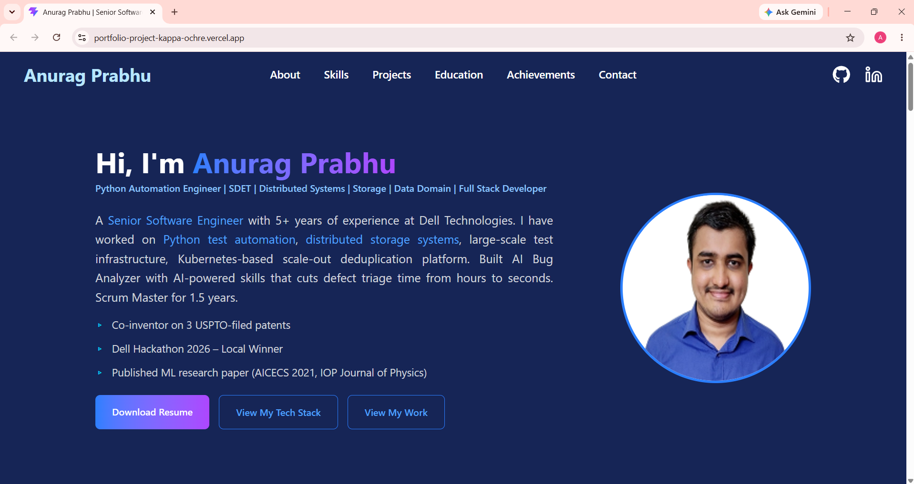

# Anurag Prabhu | Portfolio

A responsive personal portfolio website showcasing my skills, projects, and education.

**Live site:** https://portfolio-project-kappa-ochre.vercel.app/



## About

I'm a Senior Software Engineer with 5+ years of experience at Dell Technologies.

Python Automation Engineer | SDET | Distributed Systems | Storage | Data Domain | Full Stack Developer

This portfolio is a place to share my work, background, and ways to get in touch.

## Features

- Responsive layout for mobile, tablet, and desktop
- Sections for About, Skills, Projects, Education, Achievements, and Contact
- Sticky navbar with smooth scrolling and a mobile menu
- Data-driven sections: skills, projects, and education are edited from simple arrays
- Portfolio view counter stored in Upstash Redis
- Session-based view counting prevents repeated counts from StrictMode or repeated visits in the same browser session
- Contact form
- Dark theme with gradient accents

## Tech stack

- **React**: component-based UI
- **Vite**: fast dev server and build tool
- **Tailwind CSS**: utility-first styling
- **React Icons**: icon set
- **Upstash Redis**: persistent portfolio view count
- **Vercel**: hosting

## Getting started

### Prerequisites

- Node.js (LTS version)
- npm

### Installation

```bash
git clone https://github.com/AnuragPrabhu666/Portfolio-Project.git
cd Portfolio-Project
npm install
```

### Run locally

```bash
npm run dev
```

Open the local URL shown in the terminal (usually http://localhost:5173).

### Build for production

```bash
npm run build
npm run preview
```

## Project structure

```
├── public/              Static files (photo, resume, project images)
├── src/
│   ├── components/      Navbar, About, Skills, Projects, Education, Achievements, Contact, Footer
│   ├── App.jsx          Page layout
│   ├── index.css        Tailwind import and global styles
│   └── main.jsx         App entry point
├── api/
│   └── views.js         Serverless endpoint for reading and incrementing the view count
├── index.html
├── package.json
└── vite.config.js
```

## Customizing

- **Skills, projects, education:** edit the arrays at the top of each component file.
- **Photo and resume:** replace `public/profile.png` and `public/resume.pdf`.
- **Contact form:** set your form endpoint in `src/components/Contact.jsx`.
- **View counter:** configure `KV_REST_API_URL` and `KV_REST_API_TOKEN` in Vercel or your local environment.

### View counter

The footer displays a live portfolio view count. The `/api/views` serverless function uses Upstash Redis:

- `POST /api/views` increments and returns the total count.
- `GET /api/views` returns the current count without incrementing it.

The first visit in a browser session increments the count. The footer retrieves the count without incrementing on subsequent visits in that session.

## Deployment

The site is deployed on Vercel. Every push to the `main` branch triggers a new build automatically.

## Contact

- GitHub: https://github.com/AnuragPrabhu666
- LinkedIn: https://linkedin.com/in/anurag-prabhu-20b928174
- Email: anuragprabhu666@gmail.com

## License

This project is for personal use. Feel free to take inspiration from it, but please don't copy it as your own portfolio.